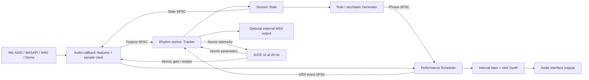

# 実装構造

## 境界と所有権

- `Core.h/.cpp`: JUCE非依存。特徴抽出、Tracker、State、Generator、BeatClock、Scheduler、Synth。
- `Engine`: JUCEデバイスのライフサイクル、SPSC、ワーカー、ファイル・デモ入力。デバイスの停止/変更時はワーカーをjoinしてからキューと音声状態をリセット。
- `Main`: 設定画面と20 Hzの表示。音声バッファを触らない。
- `Render`: 実録音も合成入力も同じCoreに流す非リアルタイム検証。WAV、MIDI、5 ms間隔CSVを書き出す。
- `AudioProbe`: JUCE実デバイスの無音出力コールバックを実時間で測定。入力は合成でありマイク精度検証ではない。

コールバックではヒープ確保、ロック、ファイルI/O、OS MIDI送信、GUI更新を行わない。SPSCのpush失敗は待たず破棄しカウントする。キューのリセットは両端停止中のみ。atomic float/doubleはWindows x64前提。メモリ容量は固定（ファイルは停止中に最大10分だけ読込）。

## 時間と同期

時間単位は入力サンプル数 / 実デバイスのsample rate。解析5 ms hopの時刻をStateに含め、出力側が現在時刻へ外挿する。ドライバー報告の入力+出力遅延と手動Timing trimで拍を先へ投影する。これは報告値ベースの補償であり物理ループバックの校正値ではない。

Phraseのnoteは絶対秒でなく連続拍座標で保存。テンポ変化で未来の全noteの発音時刻が変わる。BeatClockは位相を逆戻りさせず速度を微調整して重複発音を避ける。途中参加では過去のnoteをまとめて発音しない。4小節固定スロット、2小節先読み。epochで停止/再同期前の生成結果を捨てる。

解析更新が250 ms以上古ければ、音源をreleaseし同期復帰まで休む。通常の低信頼度では現在BPMの周辺を維持。生成だけが間に合わない小節は直近コードルートの4分音符に縮退する。長時間の停止は1.25秒以上（テンポ依存）で認識するため、停止と短い休符の識別は即時ではない。

MIDIはワーカーの1 msポーリングとOS/外部音源の遅延を含む。v0.2ではベースchannel 1、ギターchannel 2、ピアノchannel 3。note offは32音の固定配列で拍座標を管理し、停止/デバイス変更では各channelへAll Notes Off。詳細は[3楽器の実装](ENSEMBLE-V02.md)。

## 音楽・拡張契約

Auto keyはドラムから調性を推定せず、生成器が選択する。4/4・マイナーを前提に、コードルートを2小節単位で共有。Rock/Funk/Shuffleで発音格子が異なる。密度・音量・フィル候補が装飾とvelocityを変える。キー/ジャンル/密度変更は生成済みの最大2小節を過ぎて反映。

将来はStateにHarmonySource（Auto / HumanGuitar）、ChordEvent、セクションを加え、HumanGuitarを優先する。複数楽器は一つのHarmonyTimelineを参照する。モデルの出力を検証・音域制約したPhraseに変換し、別推論ワーカーのキューへ接続する。現在の生成器を重い推論に直接置換して解析ワーカーを止めてはいけない。
